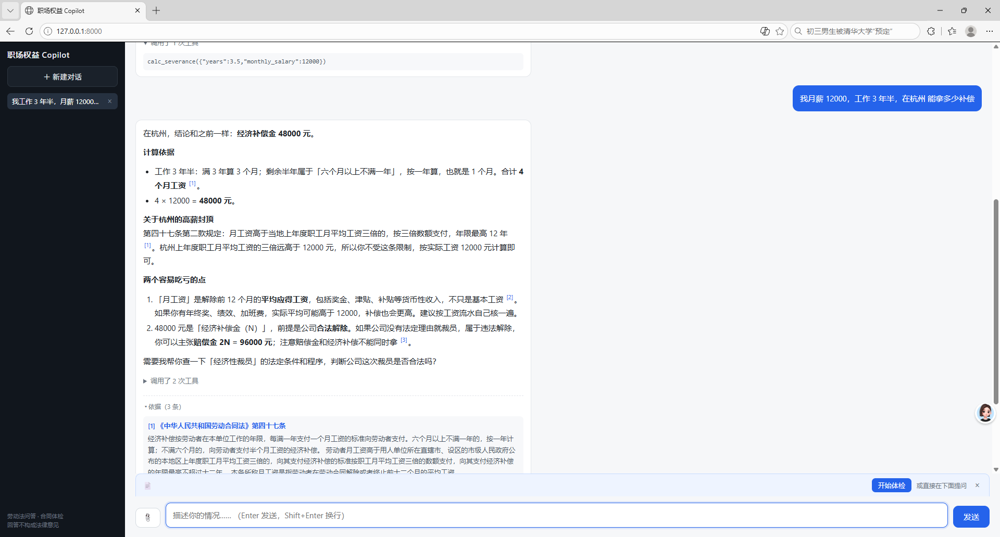
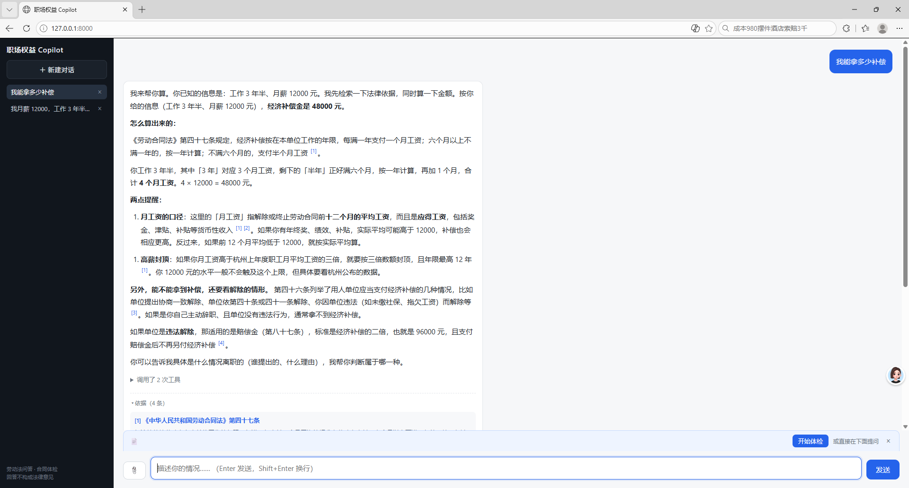
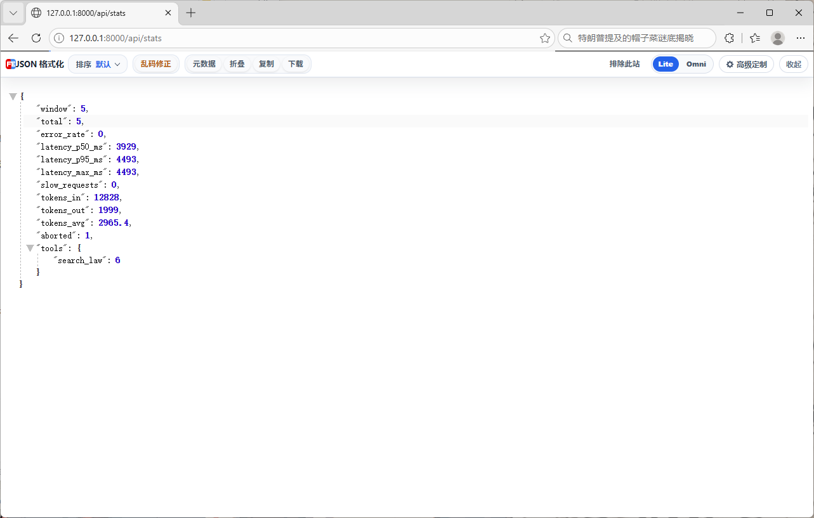
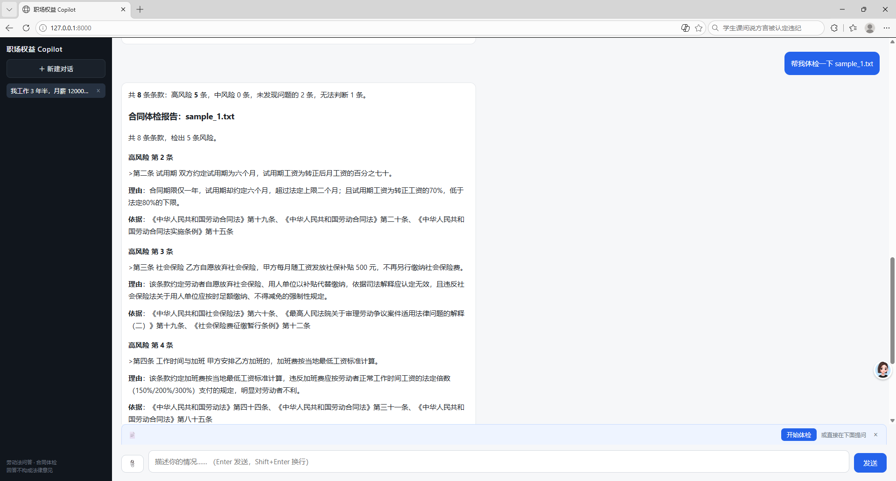

# 职场权益 Copilot

> 劳动法 RAG 问答 Agent：1,251 条法条零切分检索 + 三个工具（检索 / 算补偿 / 体检合同），
> 答案里每个结论标注法条编号、可点开看原文。



| 关键指标 | 数字 |
|---|---|
| 检索 HitRate@5（40 条测试集，34 条可判定） | **0.735**（BM25 0.500 / RRF 混合 0.647） |
| 生成 faithfulness（Ragas，34 条） | **0.919** |
| 端到端答案正确率（10 题口语） | BM25 **3/10** → 向量 **9/10** |
| 合同体检（5 份 38 条） | 检出 **12/12**，误报 **0/26** |
| 检索耗时占端到端 | **7–9%**（瓶颈在 LLM 往返，不在检索） |

技术栈：Python 3.12 · LangGraph · bge-m3 · Milvus · FastAPI · SSE · 原生 HTML/JS

---

## 一、解决什么问题

普通人遇到劳动纠纷，要解决三件事：**哪条法律管用、能赔多少、合同有没有坑。**

直接问通用大模型有三个问题：

| 问题 | 后果 |
|---|---|
| **不知道具体条文** | 说「按劳动法规定」但说不出第几条，无法核对 |
| **会编法条** | 引用不存在的条款，用户拿去维权会吃亏 |
| **算不出准确数字** | 「大概几个月工资」，而补偿金是「3.5 年折算 4 个月 × 12000 = 48000」 |

这个项目用 RAG + 工具调用解决：**检索命中真实法条、编号可追溯、金额用代码算而不是让模型估。**

领域上还有个特殊性——**法条是天然的结构化单位，不该切块。**
一条法条自带完整的「条件 + 后果」，切开会丢「但是」「除外」这些关键转折，
所以本项目 **1 条法条 = 1 个检索单元**，全库 1,251 条。这一个决定影响了后面所有设计。

---

## 二、怎么做

```
                        ┌──────────────────────────────┐
用户提问 ──▶ FastAPI ──▶│ LangGraph Agent（ReAct）      │
              │         │  ├ search_law   法条检索      │
              │         │  ├ calc_severance 补偿金计算  │
              │         │  └ check_contract 合同体检    │
              │         └───────────┬──────────────────┘
              │                     │ 每次检索 → RefPool 分配全局编号
              ▼                     ▼
        SSE 流式推送          答案 + citations（编号可点开原文）
```

三个工具都通过 `RefPool` 统一编号：**同一个法条在整个会话里始终是同一个编号**，
所以多轮追问时 `[3]` 不会指向两条不同的法。

### 五个关键决策

**① 法条零切分**

不用 chunking，1 条法条 = 1 个检索单元（最短 20 字 / 中位 86 字 / 最长 797 字）。
理由：法条是「条件 + 后果」的完整单位，切开会丢转折词。代价是长条文（797 字）会占较多 token。

**② 向量检索，不用 RRF 混合**

同一批 13 道题实测：BM25 命中 7/13，向量 12/13，**RRF 等权融合只有 10/13**。
原因：RRF 假设两路质量相当，而 BM25（7/13）远弱于向量（12/13），
它的 20 条候选里大量无关文档把向量排第 1 的正确结果挤了下去。所以只保留纯向量。

**③ 金额用代码算，不让模型估**

《劳动合同法》第 47 条第一款（每满一年一个月工资 / 六个月以上不满一年按一年算）
写成规则函数。模型只负责取出「工作年限」和「月薪」两个参数。
这样「3.5 年 × 12000」永远等于 48000，不受模型算术能力影响。

**④ 引用池按会话复用（`thread_id`）**

如果每轮新建池，第 2 轮的新法条又从 `[1]` 开始，模型写 `[2]` 就会被映射成**另一条法**——
编号没错、法条错了。所以池按 `thread_id` 复用；进程重启后从会话历史里的编号反推重建。

**⑤ 长期记忆 + 历史截断，是耦合的**

长期记忆只在**新建会话**时注入（续聊再注入是浪费 token，且旧条件可能已改口）。
但这带来一个问题：历史超过 6 轮要截断，**截断会把「用户说过月薪 12000」一起删掉**。
所以截断时额外把记忆注入一条 SystemMessage 补回来——**这才是「记忆让截断变安全」**。

实测：会话 A 说「我月薪 12000，工作 3 年半」，**新建对话**只问「我能拿多少补偿」——
它直接算出 48000，没有反问月薪。



---

## 三、实测数字

所有数字都在 `data/eval/` 下有明细，可以逐题追溯。

线上每个请求都会写一行 JSON（见「可观测性」），下面这张就是聚合接口：



### 1 检索（40 条分层测试集）

测试集按题型分层，避免「边做边挑题」的高估：

| 类型 | 条数 | 说明 |
|---|---|---|
| 口语 `kouyu` | 18 | 用户会怎么问 |
| 术语 `term` | 8 | 查询词几乎逐字来自法条 |
| 多步 `duobu` | 8 | 一题含两个法律问题，需要多次检索 |
| 超范围 `out_of_scope` | 6 | 不属劳动法，正确行为是拒答 |

可判定题 34 条（超范围题不参与命中统计）：

| 检索方式 | HitRate@1 | HitRate@3 | HitRate@5 | MRR@5 |
|---|---|---|---|---|
| BM25（字符二元组） | 0.324 | 0.441 | 0.500 | 0.389 |
| **向量 bge-m3** | **0.441** | **0.618** | **0.735** | **0.546** |
| 混合（RRF 等权） | 0.353 | 0.529 | 0.647 | 0.459 |

按题型拆分（向量）：

| 类型 | 条数 | HitRate@5 | MRR@5 |
|---|---|---|---|
| `kouyu` | 18 | 0.778 | 0.571 |
| `term` | 8 | 0.875 | 0.719 |
| `duobu` | 8 | **0.500** | **0.317** |

**短板很清楚：多步题只有 0.500。** 9 道未命中归为五类原因，写在
[`data/eval/retrieval_eval.md`](data/eval/retrieval_eval.md)：
术语落差（「调岗降薪」vs 法条写「变更劳动合同」）、一问多义、否定表达、精确词缺失、gold 标注偏窄。

### 2 生成（Ragas，34 条）

| 指标 | 全部 | 口语 18 | 术语 8 | 多步 8 |
|---|---|---|---|---|
| faithfulness | **0.919** | 0.922 | 0.975 | 0.857 |
| answer_relevancy | **0.801** | 0.865 | 0.776 | 0.680 |

faithfulness 扣分主要来自**算术结果**（48000 是算出来的，原文没有这个数字）、
**法律判断**（「不合法」是反推的）、**免责声明**（prompt 要求的正确行为，但无原文支撑）。
有 3 条得 0 分是因为答案含「未找到相关依据」被判 noncommittal，排除后为 0.878。

### 3 性能（瓶颈在哪）

| 阶段 | 耗时 |
|---|---|
| 冷启动（加载 bge-m3 + 读向量矩阵） | **4–9 秒**（98% 在加载模型） |
| 单次检索 | BM25 约 4 ms / 向量约 165–205 ms（几乎全是编码） |
| 端到端问答 | 无工具 1.5–2.5 秒 / 有工具 5–24 秒 |
| 合同体检 | 一条 1.3–1.6 秒（8 条约 11–13 秒） |

**结论：检索只占端到端 7–9%，瓶颈全在 LLM 往返和工具调用轮次。**
所以优化方向是「少调几次工具」，不是「把检索做快」。

### 4 双后端对比（numpy vs Milvus）

法条检索做了两套接口一致的实现，用 `VECTOR_BACKEND=numpy|milvus` 切换。
20 条 query，每条 5 次，首次丢弃：

| 项 | numpy（暴力矩阵乘） | Milvus（HNSW） |
|---|---|---|
| 纯检索 P50 | **0.36 ms** | 4.71 ms |
| 编码 P50（同一个 bge-m3） | 106.51 ms | 107.55 ms |
| 元数据过滤 P50 | 0.43 ms | 5.00 ms |
| 召回一致性（top-5 重合） | 基准 | **100 / 100** |

**默认用 numpy。** 快 13 倍，差异来自 gRPC 往返而非图搜索；召回完全一致；
编码占 99.7%，检索差几毫秒用户感觉不到。
Milvus 的价值不在速度，在**元数据过滤 / 增量更新 / 多租户隔离**——
数据量上到十万级或需要按地域、时效过滤时才值得。

> **⚠️ 注意：这个项目接 Milvus，主要是为了学习和扩宽知识面，不是它在这里不可替代。**
> 1,251 条这个规模，numpy 又快又准（0.36 ms、召回 100%），根本用不到向量库。
> Milvus 在本项目里唯一的**真实**用途是长期记忆——那需要按 `user_id` 过滤 + `upsert` 覆盖，
> 恰好是向量库擅长的事。法条检索接 Milvus 纯粹是「顺便验证一下双后端能不能同接口切换」。

### 5 合同体检

5 份自造合同、格式各异（第X条 / 数字 / 中文序号 / 无编号 / 混合），共 38 条：

| 指标 | 结果 |
|---|---|
| 切分 | 5 / 5 份（8 / 9 / 6 / 5 / 10 条） |
| 检出率 | **12 / 12** |
| 误报率 | **0 / 26** |

逐条比对法条判断风险（高 / 中 / 无 / 无法判断），SSE 推「第 3/8 条」实时进度。
切分以**空行为主、编号为辅**——合同天然用空行分隔条款，纯按编号会漏掉无编号的合同。



---

## 四、我砍掉了什么

这部分比「加了什么」更能说明判断力。每条都是实测后放弃的。

| 砍掉的 | 实测数据 | 原因 |
|---|---|---|
| **chunking** | — | 法条是原子单位，切了会丢「但是/除外」；1,251 条这个规模也不需要切 |
| **RRF 混合检索** | 10/13 < 纯向量 12/13 | BM25 太弱，它的无关候选把正确结果挤下去 |
| **Milvus 做法条检索** | 慢 13 倍，召回一样 | 1,251 条时向量库是过度设计；保留它只用于记忆和多租户 |
| **摘要式历史压缩** | — | 会把「月薪 12000」糊成「一万多」，那就没法算补偿了。改成截断 + 记忆补回 |
| **Docker 部署** | 构建失败 4 次 | 本机环境问题（VMware 桥接驱动拦容器 TCP、pytorch CPU 源超时、C 盘不够 11 GB 镜像）。已删除相关文件 |

---

## 五、已知局限

**数据层**

- 只覆盖**国家层面**法律，各省《劳动合同条例》等地方性法规不在数据集内
- 部门规章（人社部通知、批复）覆盖不全
- 数据截至 2026-10-21；上游 14 部行政法规的施行日期为空（326 / 1,251 条），未用公布日期顶替

**能力层**

- **多步题 HitRate@5 只有 0.500** —— 一题含两个法律问题时，一次检索只覆盖一半（见上表）
- **否定表达不敏感** —— 「没培训也没调岗」这类，向量检索容易漏
- 长会话用的是**截断**不是摘要：超过 6 轮的老对话直接删，只靠记忆补回关键事实

**工程层**

| 项 | 现状 |
|---|---|
| 鉴权 | **没有登录体系**，`user_id` 是浏览器本地生成的 UUID（存 localStorage）→ 换设备就丢记忆，共用设备会串号 |
| 限流 | **没做**。生产需要 Redis + `INCR` 滑动窗口，否则「每分钟 N 次」在多进程下会失效 |
| **Milvus 依赖** | 法条检索**不依赖**（走 numpy）；**长期记忆完全依赖**——不起那三个容器，这个功能就是**关着的**（不注入、不记新事实） |
| 存储 | sqlite 存会话和 Milvus 存记忆，都只支持单机 |
| 部署 | **没做**（见上一节） |
| 统计口径 | `/api/stats` 只读最近 500 条，不是全量 |

---

## 六、跑起来

```bash
# 1 环境
pip install -r requirements.txt      # 注意 langchain-community 保持 0.3.30，单独升级会和 ragas 不兼容

# 2 配 Key
cp .env.example .env                 # 只有 DEEPSEEK_API_KEY 是必填的

# 3 起服务（首次会下载 bge-m3 约 2.2 GB）
python -m uvicorn app.main:app --host 127.0.0.1 --port 8000
```

打开 `http://127.0.0.1:8000/` 就是完整界面，`/docs` 是接口文档。

**语料和向量已随仓库提交**：`data/clean/articles.jsonl`（0.71 MB / 1,251 条）、
`data/clean/articles_vec.npy`（4.9 MB / 1251 × 1024）。不用重建就能直接跑。

### 长期记忆：必须起 Milvus，不起就是关着的

**⚠️ 长期记忆是唯一真正依赖 Milvus 的功能**——它把用户事实存在 Milvus 的 `user_memory` 集合里，
按 `user_id` 过滤召回。**不起容器，这个功能不是「效果差一点」，是「完全用不了」：**
既不会注入你上次说过的条件，也不会记住这次说的。

```bash
cd milvus && docker compose up -d          # etcd + SeaweedFS + milvus-standalone
curl http://localhost:9091/healthz          # 应返回 OK
```

**其余功能不受影响**：问答、多轮对话、合同体检都正常——法条检索走 numpy，压根不碰 Milvus。

> **为什么法条检索不用 Milvus**：见上面「双后端对比」——1,251 条时 numpy 快 13 倍、召回一样。
> **这个项目接 Milvus 主要是学习**（建库、HNSW 索引、标量过滤、`flush` 与有效条数的区别），
> 而不是技术上必需。想直接跑通问答，完全可以不起这些容器。

### 脚本清单

| 脚本 | 作用 | 产物 |
|---|---|---|
| `W1/D1/01~05_*.py` | 语料五步管道（扫描 → 标题筛 → 密度筛 → 规则+人工选 → 展开） | `articles.jsonl` |
| `W1/D4/09_build_vectors.py` | 编码 1,251 条 → 向量矩阵 | `articles_vec.npy` |
| `W1/D3/08_easy_rag.py` | 字面检索版 RAG（答案 3/10） | `easy_rag_result.md` |
| `W1/D4/010_vector_rag.py` | 向量检索版 RAG（答案 9/10） | `vector_rag_result.md` |
| `W1/D5/011_agent.py` | 双工具 Agent | `agent_d5_result.md` |
| `W1/D7/013_hybrid_eval.py` | BM25 / 向量 / RRF 三方对比 | `hybrid_eval_result.md` |
| `W2/D8/014_build_golden_set.py` | 生成 40 条测试集（`--find` 可查法条） | `golden_set.jsonl` |
| `W2/D8/015_eval_retrieval.py` | 检索评估 + 未命中诊断 | `retrieval_eval.md` |
| `W2/D9/016_ragas_eval.py` | Ragas 生成评估 | `ragas_eval.md` |
| `W2/D10/017~018_*.py` | 合同体检 + 与人工标注比对 | `contract_check_result.md` |
| `W2/D11/019_contract_agent.py` | 体检接入 Agent（三工具） | `contract_agent_result.md` |
| `W2/D12/020_benchmark.py` | 冷启动 / 检索 / 端到端 / 体检耗时 | `benchmark.md` |
| `W4/D18/021_milvus_basics.py` | Milvus 建库、HNSW、标量过滤、`ef` 实测 | `milvus_basics.md` |
| `W4/D20/022_vector_store_bench.py` | numpy vs Milvus 延迟 / 召回 / 过滤 | `vector_store_compare.md` |
| `W4/D23/023_regression.py` | 评测回归：`--save` 存基线 / `--compare` 逐题对比 | `regression_baseline.json` |

### 目录结构（只列核心）

```
app/                    Web 层
  main.py               11 个路由（首页 / 问答 / 流式 / 会话三件套 / 合同三件套 / stats）
  deps.py               检索器单例 + 按会话的引用池 + 历史截断 + checkpointer
  streaming.py          SSE 生成器（生产者队列 + 心跳 + 事件过滤）
  memory.py             长期记忆（抽取事实 → 存 Milvus → 新会话召回）
  observability.py      每请求一行 JSON + /api/stats 汇总
  contract_stream.py    合同体检的 SSE（逐条进度）
  static/               前端单页（index.html / style.css / app.js）
src/                    核心逻辑（可脱离 Web 复用）
  retriever.py          BM25 / 向量 / 混合 / Milvus 四种检索器（后两者同接口）
  agent.py              LangGraph 图（ReAct + 工具）
  citation.py           RefPool：全局编号 + 按 id 去重
  contract.py           合同切分 / 逐条判断 / 报告（含 gbk 兼容、路径穿越防护）
  prompts.py            四份 prompt（问答 / 合同判断 / 评测 / 记忆抽取）
  tools/                search_law / calc_severance / check_contract
data/
  clean/articles.jsonl  1,251 条法条（提交）
  clean/articles_vec.npy 向量矩阵 1251×1024（提交）
  eval/                 22 个文件：评估报告 + 40 条测试集 + 回归基线 + 合同标注
  contracts/            5 份测试合同 + 人工标注 labels.json
milvus/                 Milvus 单机（etcd + SeaweedFS 顶替 MinIO + standalone）
scripts/W1 W2 W4/       按周分目录的可复现脚本
```

---

## 七、数据来源

[chinese-law-corpus](https://github.com/lttxzmj/chinese-law-corpus)（CC0），
原始出处是国家法律法规数据库（flk.npc.gov.cn）。全量 1,513 部 / 56,182 条，
本项目筛出 **30 部劳动权益相关法律 / 1,251 条**。

筛选不是纯规则：标题关键词粗筛出 31 部、正文密度扫描出 58 部，合并去重 67 部，
再**规则 + 人工剔除**到 30 部。**13 部的人工剔除理由逐条写在 `04_select.py` 的 `EXCLUDE` 字典里**——
纯规则会跑出 43 部并含明显噪声，所以最后一步必须人工过一遍。

| 步骤 | 脚本 | 输出 |
|---|---|---|
| 扫描全量 | `01_scan.py` | `_index.json` |
| 标题关键词粗筛 | `02_filter.py` | 31 部 |
| 正文密度扫描 | `03_content_scan.py` | 58 部 |
| 规则 + 人工剔除 | `04_select.py` | **30 部（白名单）** |
| 按名单展开 | `05_build.py` | **1,251 条** |

> 原始语料 33 MB 不提交，重建方式：`git clone --depth 1` 上游仓库后依次跑五个脚本。

---

## 免责声明

本项目仅用于技术演示与学习，**不构成法律意见**。法条内容请以[国家法律法规数据库](https://flk.npc.gov.cn/)为准。
遇到实际纠纷请咨询执业律师或当地劳动仲裁机构。
